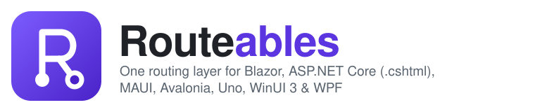
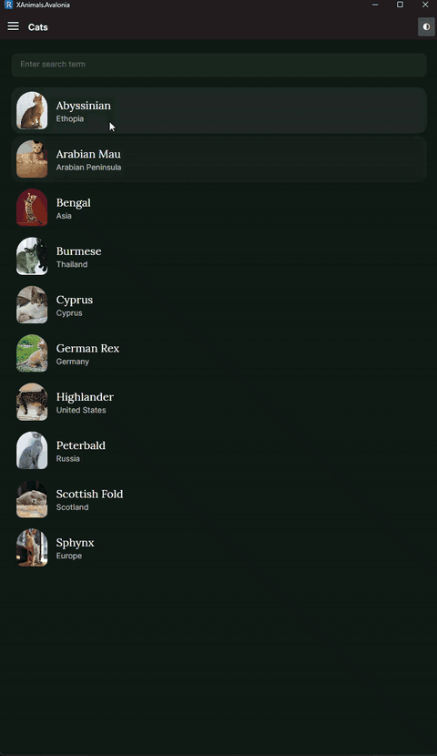
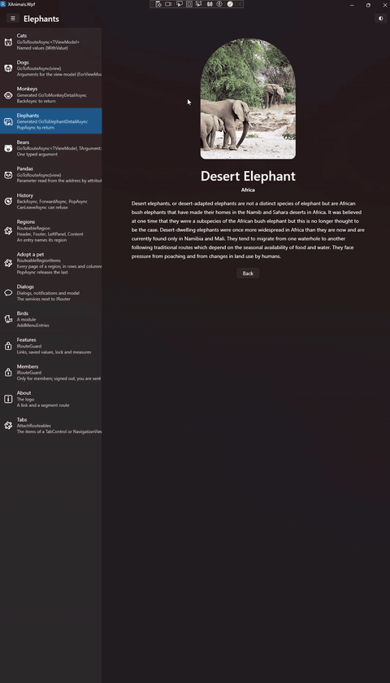
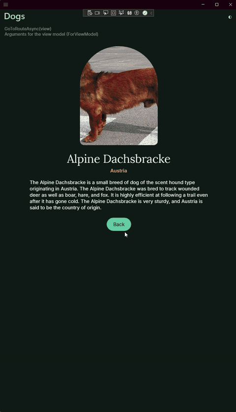
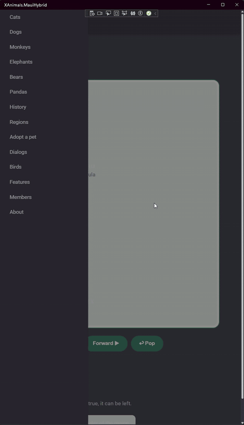
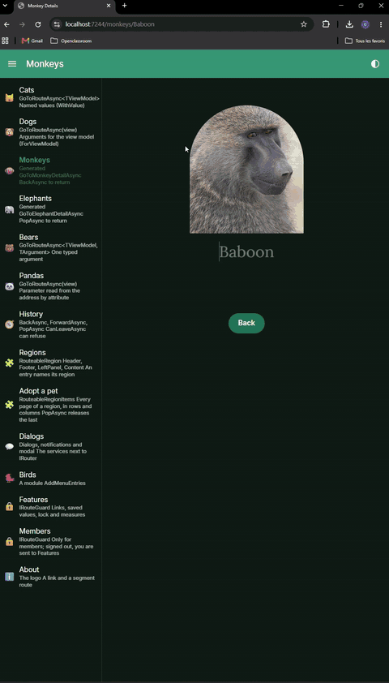
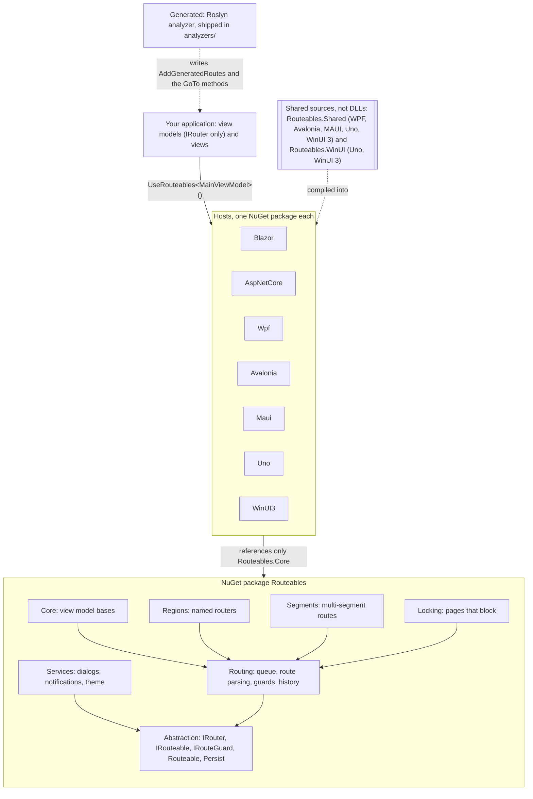

<p align="center">
  
</p>

<p align="center">
  <a href="https://github.com/cedric56/Routeables/actions/workflows/ci.yml"></a>
  <a href="LICENSE.txt"></a>
  
  <a href="https://www.nuget.org/packages/Routeables"></a>
  <a href="https://www.nuget.org/packages/Routeables.Avalonia"></a>
  <a href="https://www.nuget.org/packages/Routeables.Blazor"></a>
  <a href="https://www.nuget.org/packages/Routeables.AspNetCore"></a>
  <a href="https://www.nuget.org/packages/Routeables.Maui"></a>
  <a href="https://www.nuget.org/packages/Routeables.Uno"></a>
  <a href="https://www.nuget.org/packages/Routeables.WinUI3"></a>
  <a href="https://www.nuget.org/packages/Routeables.Wpf"></a>
  <a href="https://www.nuget.org/packages/Routeables.Abstraction"></a>
  <a href="https://www.nuget.org/packages/Reshapes.Avalonia.Fluent"></a>
  <a href="https://www.nuget.org/packages/Reshapes.Blazor.MudBlazor"></a>
  <a href="https://www.nuget.org/packages/Reshapes.Maui.Community"></a>
</p>

**View-model-first routing for .NET 10: Avalonia, WPF, .NET MAUI, Uno Platform, WinUI 3, Blazor and ASP.NET Core.**

A view model asks an `IRouter` to go somewhere. It never touches a page, a frame or a navigation API of the framework, so the same code runs on every host.

Four ideas make the whole model: a **route**, a **view**, a **region** (a zone of the screen that shows pages) and the **router**. Everything else is optional and comes later. A [glossary](docs/guides/glossary.md) explains the words.

[See the Animals sample in your browser](https://cedric56.github.io/Routeables/demo/avalonia/) (Avalonia, WebAssembly).

## Install

```bash
dotnet add package Routeables.Avalonia
```

You need the .NET 10 SDK. The package brings everything else, the source generator included. Another host? Use `Routeables.Wpf`, `.Maui`, `.Uno`, `.WinUI3`, `.Blazor` or `.AspNetCore`: [all the hosts](docs/packages.md).

## Your first page

**1. A page** is a view model with its route, and the view with the matching name:

```csharp
[Routeable("/hello/{name}")]
public sealed class HelloViewModel(string name)
{
    public string Greeting { get; } = $"Hello, {name}!";
}

public partial class HelloView : RouteableFor<HelloViewModel> { public HelloView() => InitializeComponent(); }
```

The router finds `HelloView` by its name and gives it the view model (`ViewModel`, typed).

**2. Start Routeables.** The window it shows is the one you give with `view:`:

```csharp
AppBuilder.Configure<App>()
    .UseRouteables(view: lifetime => new MainWindow());
```

> Remove the creation of the window from `OnFrameworkInitializationCompleted` in your `App`. If both create one, the application opens two.

**3. A zone** in the main view shows the pages, and `Route` is the first one:

```xml
xmlns:routeables="clr-namespace:Routeables.Avalonia;assembly=Routeables.Avalonia"
<routeables:RouteableRegion Route="/hello/World" />
```

**4. Go somewhere** from any view model that asks for an `IRouter` in its constructor:

```csharp
await router.GoToAsync("/hello/Claire");
```

To start from a template instead: `dotnet new install Routeables.Templates`, then `dotnet new routeables-avalonia -n MyApp`.

The same view models drive the Animals sample on each host: only the views differ.

<table>
  <tr>
    <td align="center"><br><sub>Avalonia</sub></td>
    <td align="center"><br><sub>WPF</sub></td>
    <td align="center"><br><sub>Uno Platform</sub></td>
  </tr>
  <tr>
    <td align="center"><br><sub>.NET MAUI</sub></td>
    <td align="center"><br><sub>MAUI Blazor Hybrid</sub></td>
    <td align="center"><br><sub>Blazor Server</sub></td>
  </tr>
</table>

## Next

- **A task to do?** The [recipes](docs/guides/recipes.md): sign-in guard, master and detail, passing an object, asking before leaving, tabs with their own history.
- **The whole first page, step by step**, with the one-line-per-page registration and the other hosts: [Getting started](docs/getting-started.md).
- **A word you do not know?** The [glossary](docs/guides/glossary.md).
- **Coming from another library?** [Migrating from Prism](docs/guides/migrating-from-prism.md), and [Routeables compared with other routers](docs/guides/comparison.md).
- **Everything it can do:** [What Routeables offers](docs/features.md), one line and one guide for each area.
- **Hosts, packages, samples:** [Hosts and packages](docs/packages.md) and the [samples](samples).
- **Using an AI assistant?** Give it [`llms.txt`](docs/llms.txt): what the library is, the few rules to follow and a link to each guide.
- [Documentation site](https://cedric56.github.io/Routeables/), [contributing](CONTRIBUTING.md), [third-party notices](THIRD-PARTY-NOTICES.md).

## Packages

The host package already holds the dialogs, modals and notifications of its framework. For MudBlazor, CommunityToolkit.Maui or FluentAvalonia dialogs, add a package of [`Reshapes`](reshapes/README.md). Everything else is in the one `Routeables` package that every host brings; its parts ([`Abstraction`](src/Routeables.Abstraction/README.md), [`Routing`](src/Routeables.Routing/README.md), [`Core`](src/Routeables.Core/README.md), [`Regions`](src/Routeables.Regions/README.md), [`Segments`](src/Routeables.Segments/README.md), [`Locking`](src/Routeables.Locking/README.md), [`Services`](src/Routeables.Services/README.md)) are separate projects of this repository.

Who depends on what: a host references only `Routeables.Core`, which builds the `Routeables` package. The code shared by the XAML hosts is not a DLL: its files are compiled into each host.



A host that referenced `Routing`, `Regions` or `Abstraction` directly would produce a package that depends on a package that does not exist. A file of `Routeables.Shared` is recompiled in five hosts, so every `#if` branch counts. The generator pairs `DogViewModel` with `DogView` and writes the registration, so routes need no reflection: this is what makes the package AOT and trimming friendly.

### On NuGet

All the packages are released together (see [VERSIONING.md](VERSIONING.md)); the current version is on each badge.

| Package | Version | What it is |
|---------|---------|------------|
| [`Routeables`](https://www.nuget.org/packages/Routeables) | [](https://www.nuget.org/packages/Routeables) | The core: router, history, regions, modules, guards, lifecycle, generator. Every host brings it; a class library of view models takes it alone. |
| [`Routeables.Abstraction`](https://www.nuget.org/packages/Routeables.Abstraction) | [](https://www.nuget.org/packages/Routeables.Abstraction) | The contracts and attributes only. |
| [`Routeables.Avalonia`](https://www.nuget.org/packages/Routeables.Avalonia) | [](https://www.nuget.org/packages/Routeables.Avalonia) | Host for Avalonia. |
| [`Routeables.Blazor`](https://www.nuget.org/packages/Routeables.Blazor) | [](https://www.nuget.org/packages/Routeables.Blazor) | Host for Blazor (Server, WebAssembly, Web App). |
| [`Routeables.AspNetCore`](https://www.nuget.org/packages/Routeables.AspNetCore) | [](https://www.nuget.org/packages/Routeables.AspNetCore) | Host for Razor Pages and `.cshtml` views. |
| [`Routeables.Maui`](https://www.nuget.org/packages/Routeables.Maui) | [](https://www.nuget.org/packages/Routeables.Maui) | Host for .NET MAUI. |
| [`Routeables.Uno`](https://www.nuget.org/packages/Routeables.Uno) | [](https://www.nuget.org/packages/Routeables.Uno) | Host for Uno Platform. |
| [`Routeables.WinUI3`](https://www.nuget.org/packages/Routeables.WinUI3) | [](https://www.nuget.org/packages/Routeables.WinUI3) | Host for WinUI 3. |
| [`Routeables.Wpf`](https://www.nuget.org/packages/Routeables.Wpf) | [](https://www.nuget.org/packages/Routeables.Wpf) | Host for WPF. |
| [`Routeables.Native`](https://www.nuget.org/packages/Routeables.Native) | [](https://www.nuget.org/packages/Routeables.Native) | System notifications (Windows, Android, Apple). |
| [`Routeables.Templates`](https://www.nuget.org/packages/Routeables.Templates) | [](https://www.nuget.org/packages/Routeables.Templates) | `dotnet new` templates: `routeables-avalonia`, `-blazor`, `-maui`, `-uno`, `-winui3`. |
| [`Reshapes.Avalonia.Fluent`](https://www.nuget.org/packages/Reshapes.Avalonia.Fluent) | [](https://www.nuget.org/packages/Reshapes.Avalonia.Fluent) | FluentAvalonia dialogs. |
| [`Reshapes.Blazor.MudBlazor`](https://www.nuget.org/packages/Reshapes.Blazor.MudBlazor) | [](https://www.nuget.org/packages/Reshapes.Blazor.MudBlazor) | MudBlazor dialogs and notifications. |
| [`Reshapes.Maui.Community`](https://www.nuget.org/packages/Reshapes.Maui.Community) | [](https://www.nuget.org/packages/Reshapes.Maui.Community) | CommunityToolkit.Maui popups. |

Routeables is the navigation layer, dialogs and notifications included. It ships no commands, view-model locator or event aggregator: use CommunityToolkit.Mvvm, ReactiveUI or plain C#.

Released under the [MIT License](LICENSE.txt).
