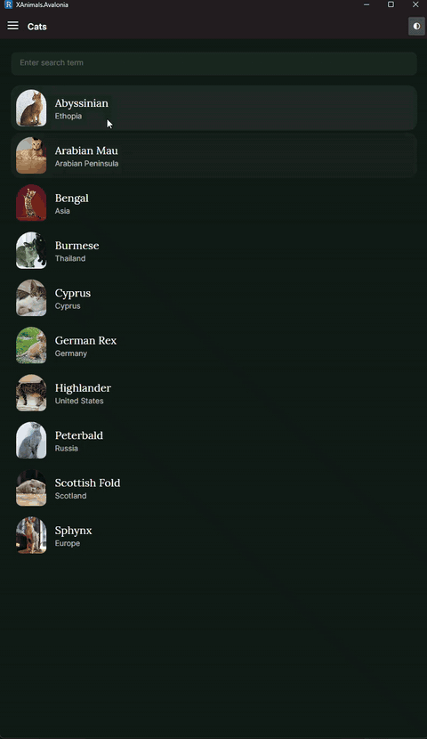
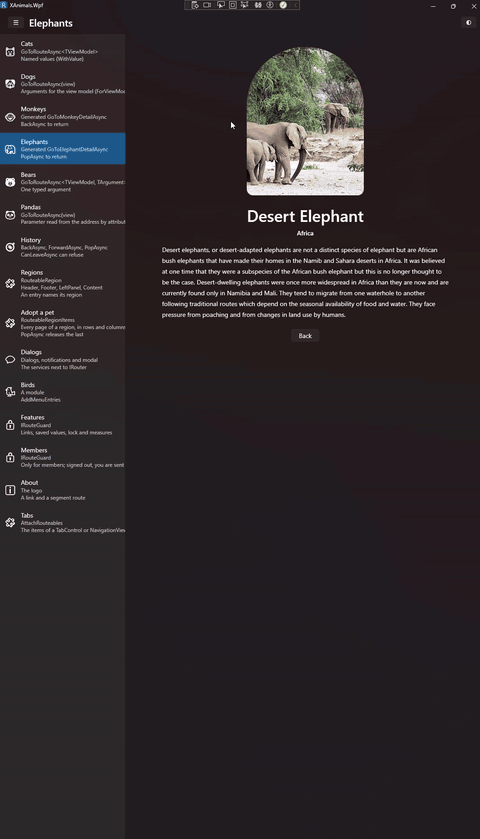
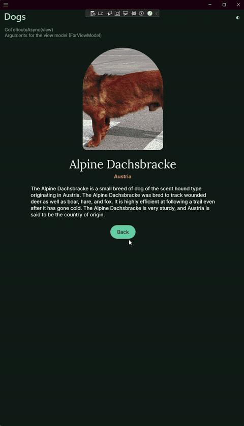
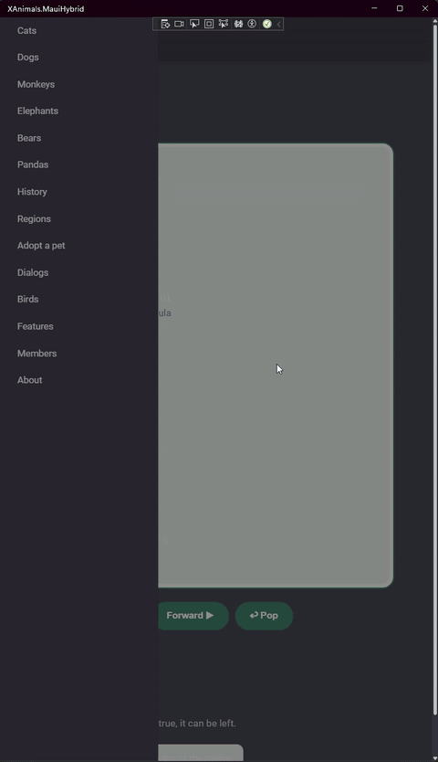
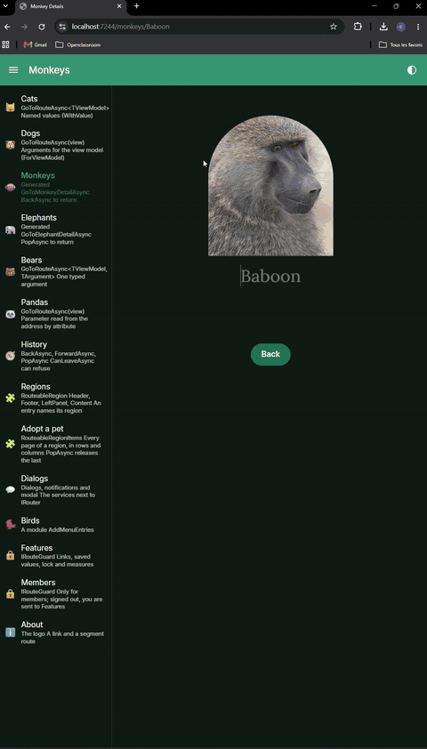

<p align="center">
  
</p>

<p align="center">
  <a href="https://github.com/cedric56/Routeables/actions/workflows/ci.yml"></a>
  <a href="LICENSE.txt"></a>
  
  <a href="https://www.nuget.org/packages/Routeables"></a>
  <a href="https://www.nuget.org/packages/Routeables.Avalonia"></a>
  <a href="https://www.nuget.org/packages/Routeables.Blazor"></a>
  <a href="https://www.nuget.org/packages/Routeables.Maui"></a>
  <a href="https://www.nuget.org/packages/Routeables.Uno"></a>
  <a href="https://www.nuget.org/packages/Routeables.Wpf"></a>  
</p>

# Routeables

**View-model-first routing and navigation for Blazor, ASP.NET Core (Razor Pages and .cshtml views), .NET MAUI, Avalonia, Uno Platform, WinUI 3 and WPF.**

A view model asks an `IRouter` to go somewhere. It never touches a page, a frame or a navigation API of the framework, so the same code runs on every host. A route, a view and a zone of the screen that shows it: that is the whole model.

Moving an existing Prism application to .NET 10? [Migrating from Prism](docs/guides/migrating-from-prism.md) maps each concept, so you can convert one screen at a time. Want to see it first? [The Animals sample runs in your browser](https://cedric56.github.io/Routeables/demo/avalonia/) (Avalonia, WebAssembly).

## Install

```bash
dotnet add package Routeables.Avalonia   # or Routeables.Blazor, .Maui, .Uno, .WinUI3, .Wpf
```

The host package brings everything else, the source generator included. You need the .NET 10 SDK.

## Your first page

**1. A view model with its route, and its view** (found by name):

```csharp
[Routeable("/hello/{name}")]
public sealed class HelloViewModel(string name)
{
    public string? Name { get; } = name;
}

public partial class HelloView : RouteableFor<HelloViewModel> { }   // Routeables.Avalonia
```

`RouteableFor<T>` is not required. A view of your own (a plain `UserControl`, `Window` or `Page`) is paired by naming the view model on it:

```csharp
[RouteableView(typeof(HelloViewModel))]
public partial class HelloView : UserControl { public HelloView() => InitializeComponent(); }
```

**2. The start of Routeables** (Avalonia shown; each host has its own line, see below):

```csharp
AppBuilder.Configure<App>()
    .UseRouteables(r => r.AddGeneratedRoutes(), view: lifetime => new MainWindow());
```

**3. The zone where pages appear, and the page it opens first**, in the main view (Blazor: the same region in your own layout, which inherits `MainLayoutBase`; the ready-made `MainLayout` has no menu to draw without a main view model and opens `/`):

```xml
xmlns:routeables="clr-namespace:Routeables.Avalonia;assembly=Routeables.Avalonia"
<routeables:RouteableRegion Route="/hello/World" />
```

**4. Go somewhere**, from any view model:

```csharp
await router.GoToAsync("/hello/Claire");
```

On Avalonia, remove the creation of the window from `OnFrameworkInitializationCompleted`: Routeables shows it. The complete first page, step by step, with the other way to register a page (one line per page, no generator): [Getting started](docs/getting-started.md).

## Your host

| Host | Package | Setup |
| --- | --- | --- |
| Blazor | [`Routeables.Blazor`](src/Routeables.Blazor/README.md) | `services.UseRouteablesServer(r => { ... })` |
| .NET MAUI | [`Routeables.Maui`](src/Routeables.Maui/README.md) | `builder.UseMauiApp<App>().UseRouteables(r => { ... })` |
| Avalonia | [`Routeables.Avalonia`](src/Routeables.Avalonia/README.md) | `AppBuilder.Configure<App>().UseRouteables(r => { ... })` |
| Uno Platform | [`Routeables.Uno`](src/Routeables.Uno/README.md) | `this.UseRouteables(r => { ... })` |
| WinUI 3 | [`Routeables.WinUI3`](src/Routeables.WinUI3/README.md) | `this.UseRouteables(r => { ... })` |
| WPF | [`Routeables.Wpf`](src/Routeables.Wpf/README.md) | `this.UseRouteables(r => { ... })` |

The block is for your own registrations, the same on every host: `r => r.AddGeneratedRoutes()`. An application with a menu gives its main view model, `UseRouteables<MainViewModel>(...)` (`UseRouteablesServer<MainViewModel>` on Blazor). To start from a template: `dotnet new install Routeables.Templates`, then `dotnet new routeables-avalonia -n MyApp` (Avalonia only for now).

The same view models drive the Animals sample on each host: only the views differ.

<table>
  <tr>
    <td align="center"><br><sub>Avalonia</sub></td>
    <td align="center"><br><sub>WPF</sub></td>
    <td align="center"><br><sub>Uno Platform</sub></td>
  </tr>
  <tr>
    <td align="center"><br><sub>.NET MAUI</sub></td>
    <td align="center"><br><sub>MAUI Blazor Hybrid</sub></td>
    <td align="center"><br><sub>Blazor Server</sub></td>
  </tr>
</table>

## When you need more

Nothing below is needed for a first page. Each line has its own guide.

| Area | What Routeables offers | Guide |
| --- | --- | --- |
| Routes | `[Routeable("/path/{id:int}")]` on the view model; view paired by name; constraints; most specific template wins; query strings | [Routes](docs/guides/routes.md) |
| Declarative navigation | `routeables:RouteableLink.Route="/hello/World"` on a button, in XAML, no code in the view model (Avalonia, WPF, Uno, MAUI) | [Routes](docs/guides/routes.md) |
| Typed routing | `GoToMonkeyDetailAsync(router, name)` generated from the constructor | [Typed routes](docs/guides/typed-routes.md) |
| Arguments | Route values, query values and objects passed to the target | [Arguments](docs/guides/arguments.md) |
| History | Back, forward, pop, back to root, move to an entry, erase; no limit by default, `LimitHistory` to set one | [History](docs/guides/history.md) |
| Regions | Several zones, each with its own router and history | [Regions](docs/guides/regions.md) |
| Lifecycle | Initialize, entering, leaving, `CanLeaveAsync` veto, `OnSubscribe`/`OnUnsubscribe`, destroy | [Lifecycle](docs/guides/lifecycle.md) |
| Guards | `IRouteGuard` with an order; allow, redirect or cancel a route change | [Routes](docs/guides/routes.md) |
| Transitions | 15 built-in transitions, custom ones registered per host | [Transitions](docs/guides/transitions.md) |
| Dialogs and notifications | One dialog service and one notification service on every host, replaceable at startup, system notifications (Avalonia, Blazor, MAUI) | [System integration](docs/guides/system-integration.md) |
| Deep links | Open a route from a URL or a system activation | [System integration](docs/guides/system-integration.md) |
| Modules | A feature is one extension method, loaded at startup or on demand | [Hosts](docs/guides/hosts.md) |
| Locking | Pages that block leaving, a locked menu | [Locking](src/Routeables.Locking/README.md) |
| Menu | `RouteableMenu` on Avalonia and WPF, items bound to routes | [Hosts](docs/guides/hosts.md) |
| Errors | `RouteableResult`, `IRouteableErrorSink` | [Lifecycle](docs/guides/lifecycle.md) |
| Diagnostics | Tracing and metrics for route changes | [Diagnostics](docs/guides/diagnostics.md) |
| Native AOT | Source generated; nothing scans assemblies at run time | [AOT](docs/guides/aot.md) |
| Hosts | Blazor, .NET MAUI, Avalonia, Uno Platform, WinUI 3, WPF | [Hosts](docs/guides/hosts.md) |
| Dialog libraries | MudBlazor, CommunityToolkit.Maui, FluentAvalonia | [Reshapes](reshapes/README.md) |

Routeables is the navigation layer, dialogs and notifications included. It ships no commands, view-model locator or event aggregator: use CommunityToolkit.Mvvm, ReactiveUI or plain C#.

## Packages

The host package already holds the dialogs, modals and notifications of its framework. For MudBlazor, CommunityToolkit.Maui or FluentAvalonia dialogs, add a package of [`Reshapes`](reshapes/README.md). Everything else is in the one `Routeables` package that every host brings; its parts ([`Abstraction`](src/Routeables.Abstraction/README.md), [`Routing`](src/Routeables.Routing/README.md), [`Core`](src/Routeables.Core/README.md), [`Regions`](src/Routeables.Regions/README.md), [`Segments`](src/Routeables.Segments/README.md), [`Locking`](src/Routeables.Locking/README.md), [`Services`](src/Routeables.Services/README.md)) are separate projects of this repository.

## Status

Routeables is young: the first commit is from October 2026, it has one maintainer, and the API is still evolving, so a few breaking changes can come with the next versions. They are named in the release notes of each version: pin the version you use and read the notes before you update. What is documented works as described, and CI tests it on every host.

## Learn more

- [Getting started](docs/getting-started.md) and the [guides](docs/guides/routes.md): routes, typed routing, arguments, lifecycle, history, regions, modules, hosts.
- [Compared with other routers](docs/guides/comparison.md): Prism, ReactiveUI, MAUI Shell, Uno.Extensions and the Blazor router, and where each one fits.
- [Samples](samples): the same Animals app on Blazor, MAUI, Avalonia, Uno, WinUI 3 and WPF.
- [Documentation site](https://cedric56.github.io/Routeables/) and API reference.
- [Contributing](CONTRIBUTING.md), [third-party notices](THIRD-PARTY-NOTICES.md).

Released under the [MIT License](LICENSE.txt).
