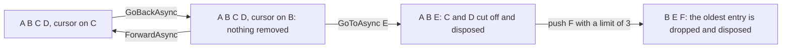
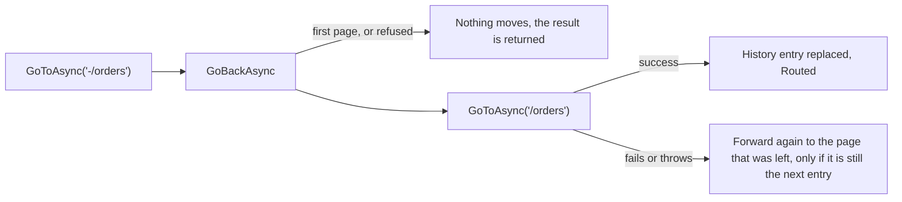

# History

## History

Each router keeps a history of entries (view model, view and arguments):

| Operation | Effect |
| --- | --- |
| `GoToAsync` (or `GoToRouteAsync`) | Pushes a new entry. Forward entries are cut off. The history has no limit by default (a scoped router keeps 50): it grows until entries are popped or erased (see below to set one) |
| `GoBackAsync` / `ForwardAsync` | Moves the cursor. Nothing is removed, so a page you went back from stays alive for `Forward` |
| `MoveToAsync(index)` | Moves the cursor to an entry |
| `GoBackToAsync("/orders")`, `GoBackToAsync<TViewModel>()`, `GoBackToAsync(entry => ...)` | Moves the cursor to the nearest earlier entry that matches (route compared without the leading `/`, the query and the case); cancelled when none does. Later entries stay, as with `GoBackAsync` |
| `GoToAsync("-")`, `GoToAsync("-/orders")` | The qualifier `-` goes back one page; `-/orders` goes back, then to `/orders`. The two steps are not one transaction: a route change requested without waiting for the first one (`GoToAsync("-/x")` and then `GoToAsync("/y")`) is queued between them, so the history ends as `/y` then `/x`; await the call, or use two calls in the order you want. A failure is not left half done: if `/orders` is refused or unknown, the router goes forward again to the page that was left (an unknown address is not a failure when `UseNotFoundRoute` is set: the page for missing addresses is shown, and the page that was left stays behind) (only when nothing else moved the history in the meantime), and the result says the second step failed. On the first page there is nothing to go back to: the result is cancelled and `/orders` is not opened. It makes a back button declarative on the XAML hosts: `<Button rt:RouteableLink.Route="-" />` |
| `GoBackAsync(steps)` | Moves the cursor back several entries in one move (one lifecycle change); cancelled when the history is shorter. The target is worked out once the route change may start (after the ones already running), as for `GoBackToAsync` |
| `GoToStackAsync(["/orders", "/orders/42"])` | Goes to each route in order, so the history gets one entry per route (deep link, wizard). Each page runs its guards and lifecycle, the intermediate pages included; stops at the first route that fails or is cancelled and returns that result |
| `PopAsync` | Goes back and removes the entry you left |
| `GoBackToRootAsync` | Returns to the first entry the history keeps (the oldest one still there when a limit has dropped older ones) |
| `EraseHistoryAsync` | Clears the history. It does not ask the page shown (`CanLeaveAsync`) and raises no `Routed`: it is for the code that owns the session (a sign-out, a restoration), not for a user move |



`-/orders` goes back, then opens `/orders` in place of the page that was left:



### Limiting the history

**What an entry weighs.** An entry keeps its view model, its **view** and its arguments, so that Back and Forward give back the same page with its state. On a desktop or mobile host the view is a tree of controls: measured on Avalonia, about 9 KB per entry for a page that is a single text, and more for a real page. After 1 000 route changes with no limit the history held 9.2 MiB; with `LimitHistory(50)` it held 0.96 MiB. An application that can go through thousands of pages in one session (a list that opens a detail, over and over) should set a limit, or use `PopAsync` to leave a page for good.

By default a history keeps every entry, except a scoped router's (Blazor Server, ASP.NET Core: one history per user session), which keeps the last 50. In an application that stays open for a long time, set a limit at startup (it also replaces the 50 of a scoped router):

```csharp
services.LimitHistory(50);                    // the default router
services.LimitHistory(20, region: "detail");  // the history of one region
```

When a push goes beyond the limit, the oldest entry is dropped and destroyed like a popped one (`OnUnsubscribe`, `Dispose`). The limit is at least 1, can be set before or after `RegisterRouting` / `AddRegion`, and is visible as `router.History.MaxSize` (`null` when there is no limit). A page you left with `GoBackAsync` is not affected until a push needs the room.

Which one to call: `GoBackAsync` for history you can come back to (a back button next to a forward one), `PopAsync` to leave a page for good (the detail opened from a list, a wizard step), which is what the samples do. Both answer `CanGoBack`.

`router.CanGoBack`, `router.CanGoForward`, `router.CurrentViewModel`, `router.CurrentView` and `router.History` describe the current state. `History.Entries` are read-only `IHistoryEntry` values: the `ViewModel`, the `View` and the `Args` of each row. Operations are serialized by a gate, so two route changes never interleave.
