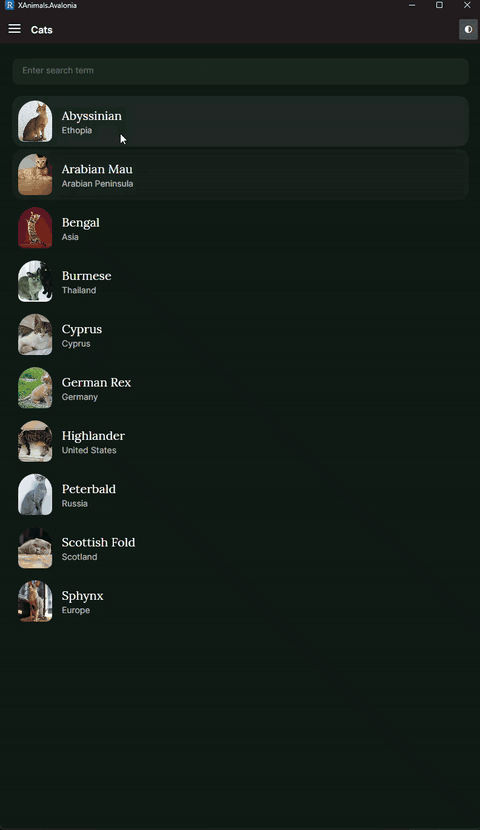
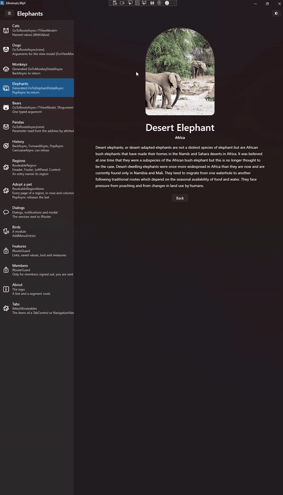
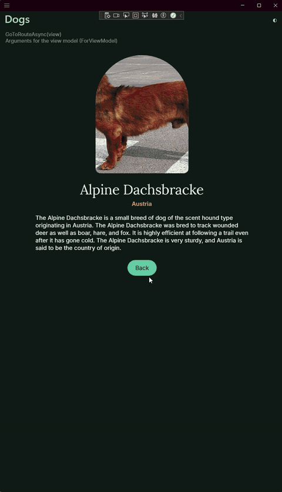
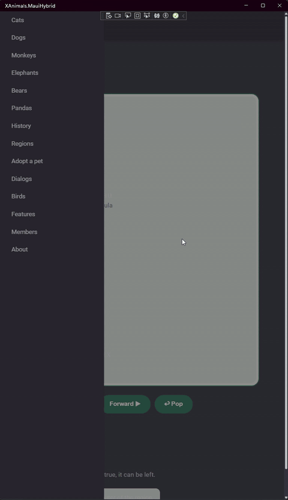
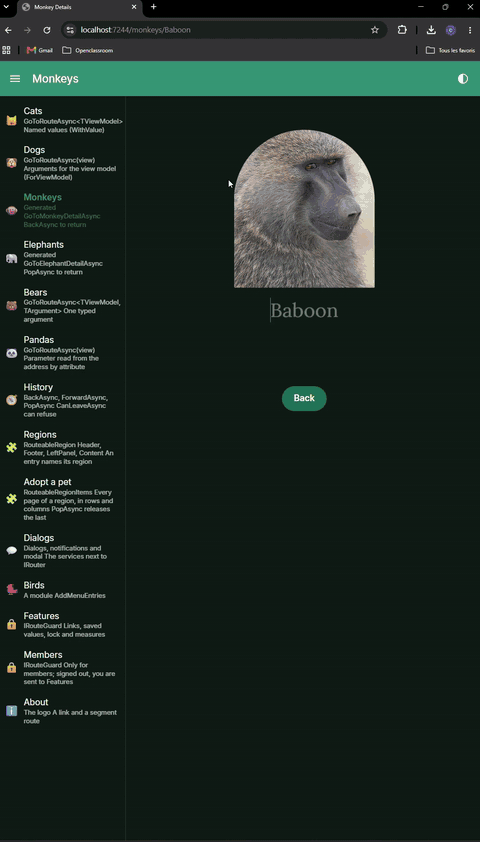

# Hosts and packages

## Your host

| Host | Package | Setup |
| --- | --- | --- |
| Blazor | [`Routeables.Blazor`](../src/Routeables.Blazor/README.md) | `services.UseRouteablesServer(r => { ... })`; the region goes in your own layout, which inherits `RouteableMainLayoutBase` (the ready-made `RouteableMainLayout` has no menu and opens `/`) |
| ASP.NET Core (Razor Pages, MVC) | [`Routeables.AspNetCore`](../src/Routeables.AspNetCore/README.md) | `services.UseRouteables(r => { ... })` |
| .NET MAUI | [`Routeables.Maui`](../src/Routeables.Maui/README.md) | `builder.UseMauiApp<App>().UseRouteables(r => { ... })` |
| Avalonia | [`Routeables.Avalonia`](../src/Routeables.Avalonia/README.md) | `AppBuilder.Configure<App>().UseRouteables(r => { ... })` |
| Uno Platform | [`Routeables.Uno`](../src/Routeables.Uno/README.md) | `this.UseRouteables(r => { ... })` |
| WinUI 3 | [`Routeables.WinUI3`](../src/Routeables.WinUI3/README.md) | `this.UseRouteables(r => { ... })` |
| WPF | [`Routeables.Wpf`](../src/Routeables.Wpf/README.md) | `this.UseRouteables(r => { ... })` |

The generated routes are added for you: in an application, the generator writes a module initializer and the host registers the routes after your block. The block is for your own services and routes, the same on every host: `r => r.AddSingleton<IClock, Clock>()`. An application with a menu gives its menu view model, `UseRouteables<MainViewModel>(...)` (`UseRouteablesServer<MainViewModel>` on Blazor). To start from a template: `dotnet new install Routeables.Templates`, then `dotnet new routeables-avalonia -n MyApp` or `dotnet new routeables-blazor -n MyWeb` (also `routeables-maui`, `-uno` and `-winui3`; none for WPF or ASP.NET Core yet).

The same view models drive the Animals sample on each host: only the views differ.

<table>
  <tr>
    <td align="center"> Avalonia</td>
    <td align="center"> WPF</td>
    <td align="center"> Uno Platform</td>
  </tr>
  <tr>
    <td align="center"> .NET MAUI</td>
    <td align="center"> MAUI Blazor Hybrid</td>
    <td align="center"> Blazor Server</td>
  </tr>
</table>

## Four families of UI, one model

Seven hosts, but four families of UI underneath. The core (router, history, regions, guards, lifecycle, the source generator)
is shared by all of them; what a host adds is the binding to its family's API.

| Family | Hosts | What they share |
| --- | --- | --- |
| Windows XAML | WPF (`System.Windows`); WinUI 3 and Uno Platform (`Microsoft.UI.Xaml`) | WinUI 3 and Uno compile the same sources ([`src/Routeables.WinUI`](../src/Routeables.WinUI)): the same API, two assemblies. WPF has its own. |
| Avalonia | Avalonia: desktop (Windows, Linux, macOS), Android, iOS, browser | One package for every platform Avalonia draws on. |
| .NET MAUI | .NET MAUI: Android, iOS, Mac Catalyst, Windows | Its own model (`Microsoft.Maui.Controls`, Shell, handlers), even where it runs on WinUI 3 underneath. |
| Web | Blazor (Server, WebAssembly, Web App, MAUI Blazor Hybrid); ASP.NET Core (Razor Pages, MVC views) | Both on ASP.NET Core; Blazor routes components, ASP.NET Core routes requests. |

Sharing code is not sharing behaviour: the same sources behave differently on each platform (rendering, accessibility,
how a drawer or a dialog is shown). So every host is tested where it runs, not once per family: the
[native smoke tests](../agent-desktop/README.md) open every page, a detail and every dialog of the Animals sample on Windows,
Linux, macOS, Android and iOS.

## Packages

The host package already holds the dialogs, modals and notifications of its framework. For MudBlazor, CommunityToolkit.Maui or FluentAvalonia dialogs, add a package of [`Reshapes`](../reshapes/README.md). Everything else is in the one `Routeables` package that every host brings; its parts ([`Abstraction`](../src/Routeables.Abstraction/README.md), [`Routing`](../src/Routeables.Routing/README.md), [`Core`](../src/Routeables.Core/README.md), [`Regions`](../src/Routeables.Regions/README.md), [`Segments`](../src/Routeables.Segments/README.md), [`Locking`](../src/Routeables.Locking/README.md), [`Services`](../src/Routeables.Services/README.md)) are separate projects of this repository.

### On NuGet

All the packages are released together (see [VERSIONING.md](../VERSIONING.md)); the current version is on each badge.

| Package | Version | What it is |
|---------|---------|------------|
| [`Routeables`](https://www.nuget.org/packages/Routeables) |  | The core: router, history, regions, modules, guards, lifecycle, generator. Every host brings it; a class library of view models takes it alone. |
| [`Routeables.Abstraction`](https://www.nuget.org/packages/Routeables.Abstraction) |  | The contracts and attributes only. |
| [`Routeables.Avalonia`](https://www.nuget.org/packages/Routeables.Avalonia) |  | Host for Avalonia. |
| [`Routeables.Blazor`](https://www.nuget.org/packages/Routeables.Blazor) |  | Host for Blazor (Server, WebAssembly, Web App). |
| [`Routeables.AspNetCore`](https://www.nuget.org/packages/Routeables.AspNetCore) |  | Host for Razor Pages and `.cshtml` views. |
| [`Routeables.Maui`](https://www.nuget.org/packages/Routeables.Maui) |  | Host for .NET MAUI. |
| [`Routeables.Uno`](https://www.nuget.org/packages/Routeables.Uno) |  | Host for Uno Platform. |
| [`Routeables.WinUI3`](https://www.nuget.org/packages/Routeables.WinUI3) |  | Host for WinUI 3. |
| [`Routeables.Wpf`](https://www.nuget.org/packages/Routeables.Wpf) |  | Host for WPF. |
| [`Routeables.Native`](https://www.nuget.org/packages/Routeables.Native) |  | System notifications (Windows, Android, Apple). |
| [`Routeables.Templates`](https://www.nuget.org/packages/Routeables.Templates) |  | `dotnet new` templates: `routeables-avalonia`, `-blazor`, `-maui`, `-uno`, `-winui3`. |
| [`Reshapes.Avalonia.Fluent`](https://www.nuget.org/packages/Reshapes.Avalonia.Fluent) |  | FluentAvalonia dialogs. |
| [`Reshapes.Blazor.MudBlazor`](https://www.nuget.org/packages/Reshapes.Blazor.MudBlazor) |  | MudBlazor dialogs and notifications. |
| [`Reshapes.Maui.Community`](https://www.nuget.org/packages/Reshapes.Maui.Community) |  | CommunityToolkit.Maui popups. |
