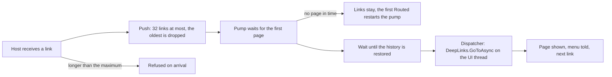

# Routeables.Services

The contracts of the optional UI services: dialogs, notifications and theme. Each host implements them and registers them in `UseRouteables`: [Razor](../Routeables.Blazor/README.md), [MAUI](../Routeables.Maui/README.md), [Avalonia](../Routeables.Avalonia/README.md), [Uno](../Routeables.Uno/README.md), [WPF](../Routeables.Wpf/README.md). Routing does not need any of this. Targets **.NET 10**, namespace `Routeables.Services`.

| Inject | For |
| --- | --- |
| `IRouteableDialogService` | Message boxes, content dialogs (a dialog that hosts a view and its view model) and task dialogs (a header, buttons and progress) |
| `IRouteableNotificationService` | Toast notifications |
| `IRouteableRequestedThemeService` | Light, dark or system theme (registered by the host) |
| `IRouteableDispatcher` | Runs work on the thread of the interface, from any thread (registered by the host) |

```csharp
// DialogsViewModel.cs of the XAnimals sample
public async Task ShowYesNoAsync()
{
    var yes = await _dialogs.ShowYesNoAsync("Add the polar bear to your favorites?", "Favorites");
    // ...
}
```

Every host behaves the same way: a button press runs its command, then asks the `Closing` veto, then closes.

```mermaid
flowchart LR
    A[Button pressed] --> B[Its command runs]
    B --> C{"Closing veto"}
    C -->|allows| D[Dialog closes, the caller gets the result]
    C -->|vetoes| E[Dialog stays open]
``` A notification closes after five seconds unless you say otherwise (`RouteableNotificationDefaults.Never` keeps it).


## Two journeys at startup

Getting the last history back (`AddRouteableHistory`, `StartRouteableHistory`). Nothing is written before the pages are back, because the restore starts by erasing the history.

```mermaid
flowchart LR
    A[Host: StartRouteableHistory] --> B[Keeper.Start: read the store, decrypt]
    B -->|nothing kept| E[Starts empty, saves at the first Routed]
    B --> C[BeginRestore: the link inbox waits]
    C --> D[Wait for the first page, 30 s slices]
    D --> F[Restore on the UI thread through the dispatcher]
    F -->|pages shown| G[EndRestore, SaveNow, keeper active]
    F -->|cannot be shown| H[The page that is there replaces them]
```

Opening the application from a link (`RouteableLinkInbox`). A link can arrive from any thread before anything is shown.



Pages saved by the host (`Save` and `Restore`, an Android bundle for instance) are restored before any link.

The look can be replaced: see [`Reshapes`](../../reshapes/README.md) (MudBlazor, CommunityToolkit.Maui, FluentAvalonia).
